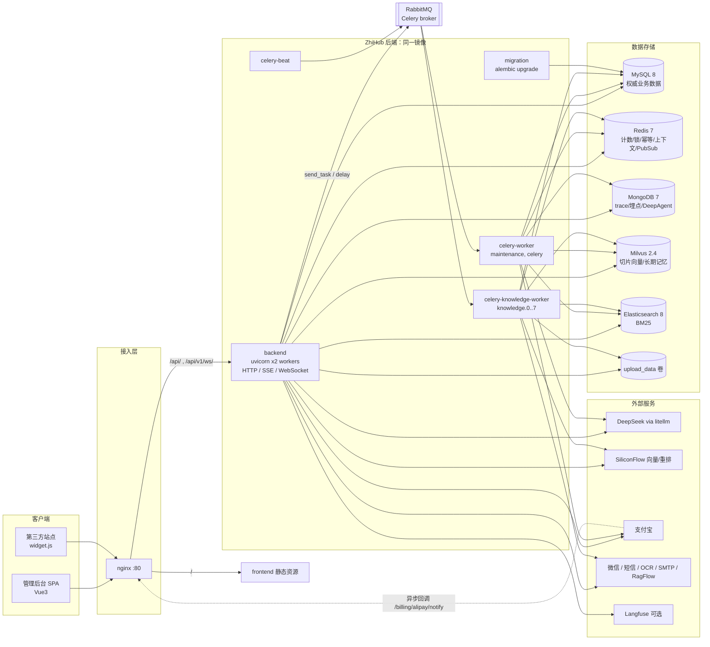

# 01 当前架构审计报告（Architecture Audit）

> 阶段：第一阶段 · 只读审计（未修改任何业务文件）
> 基线：`main` @ `7c6496b`
> 配套文档：`00_project_inventory.md`（资产）、`02_service_dependency_map.md`（依赖）、`03_database_inventory.md`（数据）、`04_testing_assessment.md`（测试）

---

## 1. 整体架构

### 1.1 一句话定位

ZhiHub 是一个**模块化单体（Modular Monolith）**：一个 FastAPI 代码库，按“API 进程 / 迁移 / 通用 Worker / 知识库 Worker / 定时调度”拆成 5 种容器角色运行，背后连接 6 类存储（MySQL、Redis、MongoDB、Milvus、Elasticsearch、本地文件卷）和多个外部 SaaS（DeepSeek/litellm、SiliconFlow 向量与重排、支付宝、微信、阿里云短信、百度 OCR、RagFlow、SMTP、Langfuse）。

技术栈以实际代码为准：Web 框架只有 FastAPI，关系数据库只有 MySQL 8.0，项目中没有 Django，也没有使用 PostgreSQL（详见 `00_project_inventory.md` 第 0 节）。

### 1.2 整体架构图



### 1.3 值得保留的优点（重构时不应破坏）

审计中发现不少成熟设计，重构必须保留其行为：

- **退款资金链路**：状态机白名单 + `version` 乐观锁 + 审批原子抢占 + Outbox 租约 + 重试前渠道对账 + 渠道幂等号 `ZH-REFUND-{approval_id}` + MySQL 触发器保证审批事件不可变（`app/services/order_service.py`、`alembic/versions/d30_*`、`d33_*`、`d37_*`）。
- **PII 加密**：AES-256-GCM 透明加密列 + HMAC 等值索引（`app/core/crypto.py`）。
- **生产配置护栏**：非开发环境拒绝默认密钥、默认口令、mock 支付、演示快速登录；功能开关打开时一次性校验所需凭据（`app/config.py:215-300`、`app/core/alipay_client.py:40-45`）。
- **鉴权 fail-closed**：Redis 不可用时 JWT 黑名单检查直接拒绝（`app/middlewares/auth_middleware.py:86-94`）；限流则有意 fail-open 并写明理由。
- **租户隔离**：`tenant_id` 只取自 JWT，CRUD 查询普遍带 `tenant_id`。
- **单一迁移轨**：生产禁止 `create_all`，Alembic 只有一个 head，CI 执行 `alembic check` 检查模型与迁移漂移。
- **跨 worker WebSocket 广播**：Redis Pub/Sub（`app/core/ws_manager.py`）。
- **分层纪律**：`crud` 层不 `commit`（0 处），没有 `services/crud/core → api` 的反向导入；事务边界集中在 service 层（69 处 `commit`）。

---

## 2. 服务边界评估

### 2.1 部署边界（容器）

| 问题 | 结论 |
|---|---|
| 是否有一个“服务”承担过多职责？ | `backend` API 进程同时承担 HTTP、SSE 长连接、WebSocket、MCP HTTP、Prometheus 指标。对当前规模可接受，但 SSE/WebSocket 长连接与普通请求共享 2 个 uvicorn worker 和线程池（见 P2-04）。 |
| 是否存在多个服务重复实现同一业务？ | 不存在多服务重复。但**同一代码库内**存在多份业务规则副本（套餐规则 4 份，见 P2-01；用量折算 2 种口径，见 P2-12）。 |
| 是否存在不合理的服务间直接依赖？ | 容器之间只通过 MySQL / Redis / RabbitMQ / Mongo 共享状态，没有容器间 HTTP 调用。问题在于**所有容器直接读写同一组表和键**，没有数据所有权约束（见 `03_database_inventory.md`）。 |
| 是否需要调整服务边界？ | **不建议拆成微服务**。理由：只有一个团队、一个代码库、一个关系库，业务之间事务耦合紧（会话结束 → 计费事件 → 配额），拆分会把本地事务变成分布式一致性问题。建议**先把模块边界做硬**（第 6 节路线图），只有在某个模块出现独立扩缩容或独立发布的硬需求时再考虑拆出，候选是“知识库处理”（已经是独立 Worker 和独立队列）。 |

### 2.2 业务模块边界（代码内）

建议按以下限界上下文看待现有代码（不是要求立刻改目录，而是作为后续治理的目标边界）：

| 限界上下文 | 现有文件 | 当前边界清晰度 |
|---|---|---|
| 身份与访问（Identity） | `auth_service`、`security`、`redis`（登录锁定/黑名单部分）、`refresh_token` | 中：`auth_service` 1014 行，覆盖 6 种登录方式；与 `session_service` 存在循环导入 |
| 租户与套餐（Tenancy） | `tenant_service`、`widget_service`、`PLAN_CATALOG` | **低**：`tenant_service` 混合了向导、邀请、Widget 配置、套餐升级、企业审批、注销 6 类职责 |
| 对话（Conversation） | `session_service`、`agent_service`、`human_service`、`ws_manager`、`agents/*` | **低**：`agent_service` 1024 行，同时编排图执行、上下文、计费标记、trace、记忆、转人工广播 |
| 知识（Knowledge） | `knowledge_service`、`retrieval_service`、`knowledge_tasks`、`embedding_client` | **较高**：对外依赖少（只依赖 `analytics_service`），有独立 Worker 和队列 |
| 交易（Commerce：订单/退款/工单） | `order_service`、`ticket_service`、`mcp_service`、`mcp_servers/*` | 较高：资金规则集中在 `order_service` |
| 计费（Billing） | `billing_service`、`billing_tasks`、`crud/billing` | 中：规则正确性存在疑点（P1-01、P1-02） |
| 运营与可观测（Ops） | `analytics_service`、`trace_service`、`audit_service`、`notification_service`、`cleanup_tasks` | 中：`cleanup_tasks` 809 行，混合周期维护与租户物理删除 |

---

## 3. 服务内部架构评估

### 3.1 现有分层

```
api/v1 (Presentation)  →  services (Application + 大部分 Domain 规则)  →  crud (Data access)  →  models (ORM)
                                     ↘ core/* (Infrastructure：客户端、Redis、加密、支付、LLM)
agents/* (LangGraph 节点) ↔ services/mcp_service → mcp_servers/* → services/order_service、ticket_service
tasks/* (Celery)  →  services/*
```

### 3.2 是否需要引入四层架构 / DDD？

**结论：不建议全面套用 Clean Architecture 或 DDD。**

- 大部分模块（通知、快捷回复、工单、分析、审计）是 CRUD + 简单规则，现有 `api → service → crud → model` 三层已足够。
- 只有**订单/退款**和**计费**两个模块有真正的领域规则（状态机、金额、审批、计费公式），可以在这两个模块内把规则抽成纯函数/领域对象（例如 `refund_policy.py`、`billing_formula.py`），以便脱离数据库做表格化测试，**不需要**引入仓储接口、领域事件总线等重型抽象。
- **对话模块**的问题不是“缺少分层”，而是“单个编排函数做了太多事”。应按职责拆成上下文存储、图执行、回复落库、后处理（trace/记忆/计费标记/广播）几个协作者，而不是引入新层。
- 应保持现有 FastAPI `APIRouter + Depends` 惯例。

### 3.3 内部架构主要问题摘要

1. **超大模块**：6 个文件超过 740 行，`agent_service`、`auth_service`、`tenant_service` 都是多职责模块（P2-07）。
2. **循环导入靠延迟导入掩盖**：`app/` 中有 **408 处**函数内 `from app.` 导入；至少存在 `tenant_service → auth_service → session_service → tenant_service` 和 `tenant_service → widget_service → session_service → tenant_service` 两条环（P2-08）。
3. **会话作用域不统一**：请求作用域 Session 通过 `Depends(get_db)` 注入，但 11 处代码自行 `SessionLocal()` 开连接（MCP 工具、Widget CORS 中间件、WebSocket、DeepAgent、转人工估时与通知），这些路径脱离请求事务、也绕过测试替换（P1-08、P2-11）。
4. **同步 IO 跑在异步上下文**：7 层 `BaseHTTPMiddleware` 中有同步 Redis 调用；4 个 `async def` 路由内直接执行同步 DB 查询（P2-02）。
5. **文档与代码漂移**：多处注释描述的行为与代码不符（P3-02）。

---

## 4. 问题清单（按 P0 / P1 / P2 / P3）

> 字段说明：每个问题包含 ① 问题描述 ② 涉及模块与文件 ③ 产生原因 ④ 对现有业务的影响 ⑤ 推荐方案 ⑥ 重构风险 ⑦ 是否需要业务验证。
> “已验证”表示我通过运行测试或命令确认过；“代码推断”表示基于阅读代码的推断，需要在真实环境复现。

### 4.0 P0（可能导致数据丢失、严重业务故障或安全事故）

**本次审计未发现可确认的 P0 问题。**

有两项问题在满足条件时建议升级为 P0：

- P1-01（月末用量漏计导致账单少收）：**业务已确认账单必须覆盖完整自然月**，因此只要表征测试复现了遗漏，就应按 P0 处理。
- P1-03（Redis 承载权威状态但无持久化）：若生产环境 Redis 也没有持久化，容器重建会丢失当日配额计数和幂等标记。

---

### 4.1 P1（严重架构缺陷，影响业务稳定性或持续迭代）

#### P1-01 每日用量聚合遗漏每月最后约 22 小时，账单可能少计超额费（代码推断）

| 字段 | 内容 |
|---|---|
| 问题描述 | 每日聚合任务在 02:00 UTC 运行，计算“当月 Redis 累计值 − 上次快照”，并把差值记在**当天**。它只处理键名中月份等于“当月”的键。每月 1 日 02:00 运行时，当月已切换到新月份，上个月的键被跳过，因此上个月最后一天 02:00 之后到月底的用量永远不会写入 `usage_records`。月初账单再按 `usage_records` 汇总上个月，只有在上月**一条记录都没有**时才回退读 Redis。 |
| 涉及文件 | `backend/app/tasks/billing_tasks.py:97-118`（`month = today.strftime("%Y-%m")`、`_queue_daily_usage` 中 `parts[3] != month` 跳过）；`backend/app/services/billing_service.py:367-384`（`_period_conversation_count` 仅在汇总为 0 时回退 Redis） |
| 产生原因 | 聚合以“运行时刻所在月”为口径，缺少对上月键的最终结算步骤；同时“落库记录所在日期”与“用量实际发生区间”错位一天。 |
| 业务影响 | 有超额的租户，每月约 1/30 的用量未计入超额费；`usage_records` 的日期也与实际使用日不一致，影响用量导出和对账。 |
| 推荐方案 | 先写**表征测试**复现（构造上月 30 日 02:00 后的用量，断言账单是否包含）。确认后：月初账单生成前，对上月键做一次最终结算；或改为以会话计费事件（`billing_events`，已在 MySQL 永久保存）为账单唯一来源。 |
| 重构风险 | 高。改变账单金额属于对外可见的资金行为变更，历史账单不可追溯修改，需要明确生效月份。 |
| 业务验证 | **已确认（2026-11-13）：账单必须覆盖完整自然月，不能遗漏月初或月末数据。** 时区处理暂不改变。仍待确认：是否需要补收历史月份差额。 |

**现有时区约定（只做记录，不做改动）**：

| 来源 | 约定 |
|---|---|
| 代码 | 统一按 **UTC 自然月**：Redis 月度键 `billing:quota:{tenant}:{YYYY-MM}` 按 UTC 当前月生成（`billing_service.py:61-71`）；每日聚合以 UTC 日期记账（`billing_tasks.py:97`）；账单账期 `period` 按 UTC 计算上月（`billing_tasks.py:154-158`） |
| 调度 | Celery 未配置 `timezone`，按默认 UTC 调度：每日聚合 02:00 UTC、账单 每月 1 日 03:00 UTC（`celery_worker.py:27-37`；`billing_tasks.py:7,89,138` 的文档字符串也写明 UTC） |
| 测试 | 提交 `d8f86ec`“账单契约按当前 UTC 月读取用量”把契约测试改为按当前 UTC 月取数 |
| 产品文档 | PRD 只写“每月账单周期结束，定时任务读取当月 `usage_records` 生成账单”，**没有约定时区** |
| 数据库时间 | `created_at`/`updated_at` 由 MySQL `NOW()` 生成；`cleanup_tasks.py:62` 的注释假设其为 UTC，Compose 未设置 MySQL 时区（容器默认 UTC）。生产 MySQL 时区未核实 |

结论：现有实现的隐含约定是“**UTC 自然月**”，但没有写成正式的业务规则。在此约定下，北京时间每月 1 日 00:00–08:00 的用量计入上一个账期。修复 P1-01 时应保持 UTC 口径不变，只补齐月末遗漏的数据；如果将来要改为北京时间口径，需要单独决策。

#### P1-02 账单超额判定的配额口径与实时预警口径不一致（代码推断）

| 字段 | 内容 |
|---|---|
| 问题描述 | 实时预警和用量页面用 `get_tenant_quota()`：若租户设置了 `quota_conversations_per_month > 0` 就用自定义配额，否则用套餐配额。月度账单 `generate_invoice()` 直接用 `PLAN_QUOTA.get(plan_type)`，**忽略**租户自定义配额。 |
| 涉及文件 | `backend/app/services/billing_service.py:419`（账单）、`:753-763`（`get_tenant_quota`）、`:54-55`（`PLAN_QUOTA` 硬编码） |
| 产生原因 | 套餐规则多处定义（见 P2-01），两个函数各自取值。 |
| 业务影响 | 对有自定义配额的租户（例如企业版议价），页面显示“未超额”但账单可能收超额费，或反过来。 |
| 推荐方案 | 统一为一个“租户有效配额”函数并被账单复用；先用表征测试固定当前行为，再由业务决定以哪个为准。 |
| 重构风险 | 中高（资金金额变化）。 |
| 业务验证 | **必须**。确认 `quota_conversations_per_month` 是否应参与账单计算。 |

#### P1-03 Redis 承载权威业务状态，但部署未配置持久化卷和内存淘汰策略，且部分键永不过期

| 字段 | 内容 |
|---|---|
| 问题描述 | Redis 中存放的不只是缓存，还有当月配额计数（账单回退来源）、每日聚合快照位点、计费事件去重标记、退款幂等键、坐席认领锁、邀请令牌、逾期降级标记。Compose 中 Redis 没有数据卷、`mem_limit: 256m`、未配置 `maxmemory`/`maxmemory-policy`。计费事件标记 `billing:event:{event_key}` 设计为**永不过期**，每个结算会话一个键，持续增长。 |
| 涉及文件 | `deploy/docker-compose.yml:107-119`；`backend/app/services/billing_service.py:112-126`（无 TTL 标记）；`backend/app/tasks/billing_tasks.py:40-47`（快照键）；`backend/app/core/idempotency.py`；`backend/app/services/human_service.py:38-39` |
| 产生原因 | 把 Redis 当作“又快又持久”的存储使用，但部署配置按缓存对待。 |
| 业务影响 | ① 容器重建（`docker compose up --force-recreate`、升级、宿主机重启后镜像变更）会清空当日配额计数和快照，导致少计用量、预警重复发送；② 键数量单调增长，256MB 用满后写入失败（无淘汰策略时 Redis 返回 OOM 错误），会连带影响登录（黑名单检查失败时拒绝请求）和限流；③ `has_online_agent` 等 `SCAN` 操作随键数增长变慢（P2-05）。 |
| 推荐方案 | 短期：为 Redis 加持久化卷并开启 AOF；评估内存上限；给 `billing:event:*` 设置一个远长于重放窗口的 TTL（例如 400 天），数据库 `billing_events.event_key` 唯一约束已能兜底去重。中期：把“账单来源”从 Redis 计数迁移到 MySQL 事件表（与 P1-01 一并处理）。 |
| 重构风险 | 中。修改部署配置需要停机窗口和数据迁移演练；修改 TTL 需要确认重放窗口。 |
| 业务验证 | 需要。确认生产环境 Redis 的真实部署方式（是否同为 Compose、是否有持久化）和可接受的数据丢失窗口。 |

#### P1-04 一个 `APP_SECRET_KEY` 同时用于 JWT 签名、PII 加密、HMAC 索引，无法独立轮换

| 字段 | 内容 |
|---|---|
| 问题描述 | AES-GCM 加密密钥和 HMAC 密钥都由 `SHA256(app_secret_key)` 派生；JWT 也用同一个值签名。密文中没有密钥版本号。 |
| 涉及文件 | `backend/app/core/crypto.py:42-53,108-121`；`backend/app/config.py:26-34`；`docs/secret-rotation-runbook.md`（轮换清单不包含 `APP_SECRET_KEY`） |
| 产生原因 | 演示阶段为简化配置复用同一密钥（代码注释已写明“生产应走 KMS”）。 |
| 业务影响 | 一旦怀疑 JWT 密钥泄露需要轮换，所有手机号/邮箱/微信 openid 密文将无法解密，`phone_hash`/`email_hash` 全部失配，用户无法登录、订单与工单的手机号核验失败。即：**无法安全响应密钥泄露事件**。 |
| 推荐方案 | 拆分为三个独立密钥（JWT、数据加密、HMAC），数据加密密钥引入版本前缀（`v1:` + 密文），支持“新写新密钥、读兼容旧密钥”的滚动重加密；HMAC 密钥变更需要重算哈希列的迁移脚本。 |
| 重构风险 | **高**。涉及全量 PII 数据重加密和哈希重算，必须在备份、灰度、可回滚的前提下进行。 |
| 业务验证 | 需要。确认生产是否已有密钥管理（KMS / Vault）、是否有合规要求（如等保、个人信息保护）。 |

#### P1-05 租户状态守卫只覆盖部分接口：注销等待期/只读/已注销租户仍可写订单、工单、知识库和调用 MCP

| 字段 | 内容 |
|---|---|
| 问题描述 | `deps.require_tenant()` 的文档写明“注销等待期默认拒绝业务接口”，但它只在 `api/v1/tenant.py` 中使用（20 处）。会话创建和发消息另有 `require_active_tenant` / `require_message_allowed_tenant`。订单（创建/发货/退款审批）、工单、知识库上传、MCP `tools/call` 等路由**没有**任何租户状态检查。 |
| 涉及文件 | `backend/app/api/deps.py:59-81`；`backend/app/api/v1/order.py`、`ticket.py`、`knowledge.py`、`mcp/server.py`；`backend/app/services/tenant_service.py:133-160` |
| 产生原因 | 租户状态守卫按功能逐个加入，没有作为统一的路由依赖。 |
| 业务影响 | 处于 `pending_deletion`（30 天导出窗口）、`readonly`（试用到期/欠费）、`pending_review` 状态的租户，持有未过期 JWT（默认 120 分钟）时仍能写入业务数据，与“只读/仅导出”的产品承诺不一致。 |
| 推荐方案 | 先由业务给出“状态 × 接口”的允许矩阵，再以路由级依赖统一实施；实施前用契约测试固定当前行为。 |
| 重构风险 | 中。收紧守卫可能让某些现有用户操作开始返回 403，属于对外行为变化。 |
| 业务验证 | **必须。业务方答复（2026-11-13）：各状态下允许哪些操作仍需进一步核实，不得自行假设。** 在得到矩阵之前，本问题只作记录，不做任何代码改动；上文“业务影响”描述的是代码现状与 `deps.py` 注释之间的差异，不代表期望行为。 |

#### P1-06 `POST /api/v1/session/message` 路由在最近一次提交中被绑错函数（**已验证**）

| 字段 | 内容 |
|---|---|
| 问题描述 | 提交 `7c6496b`（标题为“拆开超长流程……保持对外行为不变”）把 `@router.post("/message", response_model=SendMessageResponse)` 留在了新插入的辅助函数 `_reject_busy_user` 上方，原来的 `send_message` 失去了装饰器。现在该接口只执行限流检查，然后返回 `None`，触发响应校验错误（500），**不再调用智能体**。 |
| 涉及文件 | `backend/app/api/v1/session.py:166-219` |
| 产生原因 | 重构时在装饰器与被装饰函数之间插入了新函数；该提交已推送到 `origin/main`。 |
| 业务影响 | 管理后台聊天窗口默认走流式接口 `/session/message/stream`；但当流式请求返回 404/405/501 或发生非 HTTP 类错误（如网络中断）时，`frontend/src/components/chat/ChatWindow.vue:208-214` 会**降级调用**该非流式接口（经 `frontend/src/api/session.ts:33-39` 的 `sendMessage`，导入时别名为 `sendMessageApi`），此时用户看到“发送失败”。其他调用方：`backend/scripts/verify_e2e.py:102`、`backend/scripts/real_mysql_smoke.py:291`、`frontend/tests/e2e/e2e-fresh.cjs:72-75`，以及任何外部 API 使用方。（第一阶段初稿称“前端页面未调用”，这是因为按函数名搜索遗漏了别名，已更正。） |
| 验证证据 | 本地全量测试中 2 个契约测试因此失败：`tests/contracts/test_session_handoff_batch3.py::TestAgentMessageHandoff::test_user_message_during_handoff_is_rejected_before_agent_execution`、`tests/contracts/test_session_lifecycle.py::TestMessageRateLimit::test_degraded_tenant_returns_200_not_500`，错误均为 `fastapi.exceptions.ResponseValidationError`。 |
| 推荐方案 | 把装饰器移回 `send_message` 上（单行改动），并增加回归测试。 |
| 重构风险 | 低（恢复原行为）。 |
| 业务验证 | 已获授权进行最小范围修复（2026-11-13）。CI 当时是否阻断这次提交仍未核实（本机无 `gh`）。 |
| **处理状态** | **已在分支 `fix/session-message-route-7c6496b` 修复，未推送、未合并**。修复后 110 个路由与完整 OpenAPI 文档和父提交 `d8f86ec` 逐字节一致；新增回归测试 `backend/tests/contracts/test_session_message_route.py`。详见 `05_fix_report_session_message.md`。 |

#### P1-07 每条消息新建一个不关闭的 Mongo 客户端，并为 trace/记忆各起一个守护线程（代码推断）

| 字段 | 内容 |
|---|---|
| 问题描述 | `trace_service._get_collection()` 每次调用都 `AsyncIOMotorClient(settings.mongo_uri)`，返回集合后客户端从不 `close()`。每条助手回复都会启动一个守护线程，在线程内 `asyncio.run(save_trace(...))`；长期记忆抽取也是每条消息一个守护线程。 |
| 涉及文件 | `backend/app/services/trace_service.py:34-49`；`backend/app/services/agent_service.py:114-130`（记忆线程）、`:479-500`（trace 线程） |
| 产生原因 | 为规避 motor 客户端绑定事件循环的问题，选择了“每次新建”。 |
| 业务影响 | 每个 Mongo 客户端自带连接池和监控线程；高并发下连接数、线程数持续增长，可能耗尽 Mongo 连接或进程资源。进程重启/滚动发布时，未完成的守护线程直接被杀，trace 与记忆数据静默丢失。测试运行中也观察到大量 `Failed to save trace: localhost:27017` 日志。 |
| 推荐方案 | trace 与记忆写入改为 Celery 任务或进程内有界队列 + 单个长生命周期同步 `pymongo` 客户端；加连接数监控。 |
| 重构风险 | 中。不影响业务结果，但影响可观测数据完整性；需压测验证。 |
| 业务验证 | 不需要业务判断；需要压测验证。 |

#### P1-08 测试环境与生产行为差异大，部分代码路径在测试中连接真实 MySQL / Mongo（**已验证**）

| 字段 | 内容 |
|---|---|
| 问题描述 | 测试用 SQLite 内存库替代 MySQL、fakeredis 替代 Redis，只覆盖 `get_db` 依赖。11 处直接 `SessionLocal()` 的代码路径和 Mongo 写入不受替换，测试运行时尝试连接 `127.0.0.1:3307` 和 `localhost:27017`。MySQL 专属行为（不可变触发器、`SELECT ... FOR UPDATE`、`Date` 列 `LIKE`、`JSON` 列、严格模式）在单元/契约测试中完全不被执行。 |
| 涉及文件 | `backend/tests/conftest.py:57-72,133-158`；`SessionLocal()` 调用点：`app/mcp_servers/order_server.py:86`、`app/mcp_servers/ticket_server.py:138`、`app/middlewares/widget_cors_middleware.py:53`、`app/api/v1/ws.py:186`、`app/services/agent_service.py:170,216`、`app/agents/deep_agent/planner.py:376` 等 |
| 产生原因 | 为了让测试无需容器即可运行，选择了 SQLite；数据库会话的获取方式不统一。 |
| 业务影响 | ① 本机全量测试耗时 **23 分 52 秒**，主要在等待连接超时；② 测试结果依赖本机是否恰好开着 MySQL/Mongo，存在不稳定性；③ 涉及 MySQL 方言的缺陷无法被单元/契约测试发现。 |
| 推荐方案 | 见 `04_testing_assessment.md`：统一会话获取入口以便测试注入；关键模块增加基于真实 MySQL 的集成测试并纳入 CI。 |
| 重构风险 | 低（只改测试基础设施和会话注入方式）。 |
| 业务验证 | 不需要。 |

#### P1-09 支付宝异步回调未校验金额、`app_id` 与卖家身份

| 字段 | 内容 |
|---|---|
| 问题描述 | 回调处理在验签通过后，只检查 `trade_status` 与 `out_trade_no` 能否解析到账单，然后把账单置为已支付。未比对回调中的 `total_amount` 与账单应付金额，也未校验 `app_id`/`seller_id`。 |
| 涉及文件 | `backend/app/services/billing_service.py:512-545`（`_apply_verified_payment`）、`:580-593`（`_locate_invoice_by_out_trade_no`） |
| 产生原因 | 依赖签名校验作为唯一防线。 |
| 业务影响 | 签名保证消息来自支付宝，但支付宝官方要求商户同时核对金额与 `app_id`，以防同一商户的其他应用或其他订单的通知被误用。当前 `out_trade_no` 由服务端生成且金额由服务端计算，实际可利用性较低，但属于资金路径的防御缺口。 |
| 推荐方案 | 在抢占账单前比对 `total_amount == base_fee + overage_fee`、`app_id == settings.alipay_app_id`；不一致时记录安全事件并拒绝入账。 |
| 重构风险 | 低到中（需确认金额格式与精度）。 |
| 业务验证 | 需要。确认是否存在部分支付、优惠抵扣等导致金额不等的正常场景。 |

---

### 4.2 P2（明显技术债务，影响维护效率和扩展能力）

#### P2-01 套餐规则在 4 处重复定义

| 字段 | 内容 |
|---|---|
| 问题描述 | `PLAN_CATALOG` 注释自称“唯一业务口径”，但配额、知识库数量、存储上限、基础费分别在其他地方另有一份。 |
| 涉及文件 | `backend/app/services/tenant_service.py:65-88`（`PLAN_CATALOG`）；`backend/app/services/billing_service.py:54-55`（`TRIAL_QUOTA`、`PLAN_QUOTA`）；`backend/app/services/knowledge_service.py:76-82`（`PLAN_KB_LIMITS`）；`backend/app/config.py:151-162`（`billing_plan_base_fees`、`storage_quota_mb`） |
| 产生原因 | 功能逐步叠加，没有统一的套餐模块。 |
| 业务影响 | 当前数值一致，但任何一次调价都需要同时改 4 处，漏改即造成显示、限额、计费三者不一致（P1-02 就是其表现之一）。 |
| 推荐方案 | 抽出 `plans` 模块作为唯一来源，其余地方只读取；配置项只用于覆盖。 |
| 重构风险 | 中（需逐个比对现值）。 |
| 业务验证 | 需要。尤其确认 `knowledge_base_limit`（注释称“知识库数量”）实际按**文档数**统计是否符合预期。 |

#### P2-02 异步路由与中间件中执行同步阻塞 IO

| 字段 | 内容 |
|---|---|
| 问题描述 | 7 层 `BaseHTTPMiddleware` 中，Auth（黑名单 `EXISTS`）、RateLimit（令牌桶）使用同步 Redis 客户端；WidgetCors 每 60 秒在中间件里同步查询全部租户。`async def` 路由 `billing.alipay_notify`、`session.send_message_stream`、`session.get_session_trace`、`widget.stream_widget_message` 和 WebSocket 处理函数中直接执行同步 DB/Redis 调用。 |
| 涉及文件 | `backend/app/middlewares/auth_middleware.py:86`、`rate_limit_middleware.py:56`、`widget_cors_middleware.py:46-67`；`backend/app/api/v1/billing.py:100`、`session.py:221,329`、`widget.py:138`、`ws.py:48-113` |
| 产生原因 | 同步 SQLAlchemy 架构与异步端点混用。 |
| 业务影响 | 每次阻塞都会暂停该 worker 上的所有请求和 WebSocket；Redis 或 MySQL 抖动时，影响会被放大到整个 worker。 |
| 推荐方案 | 需要访问同步 DB 的端点保持 `def`；确需 `async` 的端点把同步调用包进线程池；中间件中的 Redis 调用改用异步客户端或改为纯 ASGI 中间件。 |
| 重构风险 | 中（行为不变，但并发模型变化需压测）。 |
| 业务验证 | 不需要。 |

#### P2-03 SSE 流式回答经 nginx 反代时可能被缓冲（代码推断）

| 字段 | 内容 |
|---|---|
| 问题描述 | nginx 的 `/api/` 段未设置 `proxy_buffering off`，后端 `StreamingResponse` 也未返回 `X-Accel-Buffering: no`。nginx 默认会缓冲上游响应。 |
| 涉及文件 | `deploy/nginx.conf`（`location /api/`）；`backend/app/api/v1/session.py:263`、`widget.py`（流式端点） |
| 产生原因 | 流式功能在开发环境（Vite 代理或直连）验证，未在 nginx 链路下验证。 |
| 业务影响 | 生产部署下用户可能看不到逐字输出，而是等到整段生成完才显示，“首字延迟”指标失真。 |
| 推荐方案 | 在部署环境实测；若确认，为流式端点设置响应头或在 nginx 单独配置 location。 |
| 重构风险 | 低。 |
| 业务验证 | 需要在真实部署环境验证。 |

#### P2-04 流式生成每等待一个分片就占用一个默认线程池线程，且请求级 Session 跨线程使用

| 字段 | 内容 |
|---|---|
| 问题描述 | `_iter_llm_chunks` 为每个请求起一个守护线程消费同步 LLM 流，再用 `await asyncio.to_thread(event_queue.get)` 等待每个分片，等待期间占用事件循环默认线程池中的一个线程。`prepare_message_stream`、`finalize_message_stream` 把请求作用域的 `db` Session 传入 `to_thread` 在另一个线程中使用。 |
| 涉及文件 | `backend/app/services/agent_service.py:1088-1114,1127-1178` |
| 产生原因 | 用线程桥接同步 litellm 流式接口。 |
| 业务影响 | 默认线程池大小约为 `min(32, CPU+4)`；并发流式会话数接近该值时，后续流式请求和其他 `to_thread` 调用排队。客户端中途断开时，是否会留下“用户消息已提交但无助手回复”的会话状态，需要验证。 |
| 推荐方案 | 改用 litellm 的异步流式接口（`acompletion(stream=True)`）；或为流式桥接使用独立的有界线程池；明确断开时的收尾语义。 |
| 重构风险 | 中。 |
| 业务验证 | 需要确认“客户端断开”时期望的会话与消息状态。 |

#### P2-05 热路径上全键空间 `SCAN`

| 字段 | 内容 |
|---|---|
| 问题描述 | `has_online_agent` / `online_agent_count` 用 `SCAN MATCH online_agents:{tenant}:*` 判断在线坐席，再对每个键 `TTL`。`SCAN` 的成本与 Redis 总键数成正比，而不是与匹配数成正比。 |
| 涉及文件 | `backend/app/services/session_service.py:196-208`；调用方 `api/v1/session.py:365`（留言）、转人工估时 |
| 产生原因 | 用前缀键表达集合。 |
| 业务影响 | 随着永不过期的计费标记（P1-03）等键增长，转人工和留言接口越来越慢。 |
| 推荐方案 | 改为每租户一个 Sorted Set（成员=坐席，分数=过期时间戳），用 `ZRANGEBYSCORE` 查询。 |
| 重构风险 | 低到中（需兼容旧键迁移）。 |
| 业务验证 | 不需要。 |

#### P2-06 会话上下文的“读-改-写”无并发控制

| 字段 | 内容 |
|---|---|
| 问题描述 | 每轮对话先 `GET session:context:{id}`，追加消息后再 `SET` 回去。同一会话的两个并发请求（双击、多标签页、Widget 重试）会互相覆盖。 |
| 涉及文件 | `backend/app/services/session_service.py:56-80`；`backend/app/services/agent_service.py:503-525,591-612` |
| 产生原因 | 上下文用整段 JSON 存储。 |
| 业务影响 | 上下文丢失一轮，影响多轮对话质量和轮次转人工判定；数据库中的 `messages` 表不受影响。 |
| 推荐方案 | 同一会话的消息处理加短时分布式锁，或改为 Redis List 追加。 |
| 重构风险 | 低到中。 |
| 业务验证 | 需要确认同一会话是否允许并发提问。 |

#### P2-07 超大多职责模块

| 字段 | 内容 |
|---|---|
| 问题描述 | `agent_service.py`（1024 行）、`auth_service.py`（1014 行）、`tenant_service.py`（863 行，6 类职责）、`cleanup_tasks.py`（809 行，周期维护 + 租户物理删除）、`demo_seed.py`（855 行）。 |
| 涉及文件 | 见 `00_project_inventory.md` 第 4 节 |
| 产生原因 | 规格驱动逐步叠加功能。 |
| 业务影响 | 修改风险集中、评审困难；最近一次重构提交（P1-06）就是在拆分长函数时引入了回归。 |
| 推荐方案 | 按第 2.2 节限界上下文逐个拆分，**每次只做纯结构移动**，并依赖表征测试和 OpenAPI 快照验证行为不变。 |
| 重构风险 | 中（纯移动风险低，但量大）。 |
| 业务验证 | 不需要。 |

#### P2-08 服务间循环导入，依赖 408 处函数内延迟导入规避

| 字段 | 内容 |
|---|---|
| 问题描述 | 存在 `tenant_service → auth_service → session_service → tenant_service`、`tenant_service → widget_service → session_service → tenant_service` 等导入环。全仓共 408 处缩进的 `from app.` 导入。 |
| 涉及文件 | `backend/app/services/*`（依赖图见 `02_service_dependency_map.md`） |
| 产生原因 | 模块间没有明确的上下游方向约定。 |
| 业务影响 | 依赖关系不可见，导入顺序变化可能导致运行时 `ImportError`；难以做静态分析。 |
| 推荐方案 | 定义模块依赖方向（例如 Identity ← Tenancy ← Conversation），把被多方共享的查询下沉到 `crud` 或独立的小模块；引入 `import-linter` 在 CI 中约束。 |
| 重构风险 | 中。 |
| 业务验证 | 不需要。 |

#### P2-09 租户物理删除跨 6 类存储非原子执行，且在持有行锁时做外部 IO

| 字段 | 内容 |
|---|---|
| 问题描述 | 到期租户的清理先对 `tenants` 行 `SELECT ... FOR UPDATE`，然后依次删除 Mongo、Milvus、ES、Redis、上传文件，最后才删除 MySQL 数据并提交。Mongo 数据库名写死为 `zhihub`，不读取 `MONGO_URI` 中的库名。 |
| 涉及文件 | `backend/app/tasks/cleanup_tasks.py:175-246`；同样写死库名的还有 `app/services/analytics_service.py:71`、`app/core/deep_agent_store.py:25`、`app/services/trace_service.py:49,282` |
| 产生原因 | 跨存储没有事务，采用“先外部后关系库”的顺序。 |
| 业务影响 | 外部删除耗时期间长时间持有行锁；中途失败会留下“外部已删、MySQL 仍在”的半删除状态（下一轮会重试，但期间用户看到的数据不完整）。若生产 `MONGO_URI` 使用非 `zhihub` 库名，trace 和埋点**根本不会被删除**，与“到期物理删除”的合规承诺不符。 |
| 推荐方案 | 先在 MySQL 标记 `purging` 并提交释放锁，再逐个存储删除并记录进度，全部成功后删除 MySQL 数据；Mongo 库名统一从 URI 解析。 |
| 重构风险 | **高**（不可逆的数据删除逻辑）。 |
| 业务验证 | **必须**。确认物理删除的合规范围与审计要求。 |

#### P2-10 订单号/工单号全局唯一，创建订单时会暴露其他租户的订单号是否存在

| 字段 | 内容 |
|---|---|
| 问题描述 | `orders.order_no`、`tickets.ticket_no` 为全局唯一索引；`create_order` 按全局查重并返回“订单号已存在: {order_no}”。 |
| 涉及文件 | `backend/app/models/order.py`（`order_no unique=True`）；`backend/app/services/order_service.py:859-863` |
| 产生原因 | 订单号视为平台级唯一标识。 |
| 业务影响 | 租户 A 可通过创建订单探测租户 B 的订单号；不同租户无法使用各自业务系统中相同的订单号。 |
| 推荐方案 | 若业务允许，改为 `(tenant_id, order_no)` 复合唯一，并修改查重条件。 |
| 重构风险 | 高（涉及唯一约束变更与历史数据）。 |
| 业务验证 | **必须**。 |

#### P2-11 MCP 工具在智能体链路中使用独立事务

| 字段 | 内容 |
|---|---|
| 问题描述 | 智能体节点调用 `call_tool(...)` 时不传 `db`，工具服务器自行 `SessionLocal()` 并独立 `commit`。 |
| 涉及文件 | `backend/app/agents/nodes/order_agent.py:162`、`ticket_agent.py:157`、`ticket_agent_fc.py:81`；`backend/app/mcp_servers/order_server.py:83-106`、`ticket_server.py:138` |
| 产生原因 | 工具层设计为可独立调用。 |
| 业务影响 | 智能体建工单/查订单成功提交后，若本轮消息落库失败，会出现“工单已建但对话中无记录”。资金类工具 `request_refund` 不在 `agent` 角色白名单中，所以不涉及退款。 |
| 推荐方案 | 明确记录这是有意设计（工具调用是独立业务事实），并在消息元数据中记录工具调用结果，便于对账。 |
| 重构风险 | 低。 |
| 业务验证 | 需要确认可接受的一致性语义。 |

#### P2-12 用量导出明细的折算公式与计费不一致

| 字段 | 内容 |
|---|---|
| 问题描述 | 计费用 `usage_amount(model, tokens) = tokens / billing_tokens_per_conversation × 模型权重`；用量明细导出写死 `tokens / 2500.0`，不乘模型权重。 |
| 涉及文件 | `backend/app/services/billing_service.py:80-96`（计费）、`:684-692`（导出） |
| 产生原因 | 导出函数单独实现了一遍公式。 |
| 业务影响 | 使用非默认模型的租户，导出中的“是否超额”列与实际账单不一致，影响对账与客诉处理。 |
| 推荐方案 | 导出复用 `usage_amount`。 |
| 重构风险 | 低（只影响导出文件）。 |
| 业务验证 | 需要确认导出以哪个口径为准。 |

#### P2-13 Celery 可靠性与时区配置缺失

| 字段 | 内容 |
|---|---|
| 问题描述 | 未配置 `task_acks_late`、`task_reject_on_worker_lost`、任务超时、`timezone`；默认按 UTC 调度（每日聚合 = 北京时间 10:00，账单 = 每月 1 日北京时间 11:00）。Python 侧写入 UTC 无时区时间，模型的 `created_at` 由 MySQL `func.now()` 按数据库服务器时区生成，两者可能不同。 |
| 涉及文件 | `backend/celery_worker.py:13-49`；`backend/app/models/base.py`（`server_default=func.now()`） |
| 产生原因 | 使用框架默认值。 |
| 业务影响 | Worker 崩溃时正在执行的任务丢失（知识库文档可能卡在处理中，由周期维护兜底）；若 MySQL 时区不是 UTC，逾期判定、到期删除等基于 `created_at` 的比较会偏移 8 小时。 |
| 推荐方案 | 明确时区策略并写入配置；关键任务开启 `acks_late` 并保证幂等；为长任务设置超时。 |
| 重构风险 | 中。 |
| 业务验证 | 需要确认业务时区和生产 MySQL 时区。 |

#### P2-14 可观测性不统一

| 字段 | 内容 |
|---|---|
| 问题描述 | 访问日志带 `trace_id`，但业务日志不带（没有 contextvar 传递）；日志为纯文本格式；错误响应格式有 `{"detail": ...}`、JSON-RPC 信封、SSE 内嵌 `{"error": ...}` 三种；全仓 139 处 `except Exception`；没有分布式追踪（Celery 任务与发起请求无法关联）。 |
| 涉及文件 | `backend/app/main.py:68-96`；`backend/app/middlewares/access_log_middleware.py` |
| 产生原因 | 逐步叠加。 |
| 业务影响 | 线上排障需要人工拼接日志；宽泛捕获可能吞掉需要告警的错误。 |
| 推荐方案 | 统一结构化日志（JSON）+ `trace_id` contextvar + 通过 Celery headers 传递；统一错误响应模型；梳理宽泛捕获。 |
| 重构风险 | 低到中（错误格式统一需保持现有 API 契约，只能新增字段）。 |
| 业务验证 | 不需要。 |

#### P2-15 CI 门禁不完整

| 字段 | 内容 |
|---|---|
| 问题描述 | CI 不跑 `tests/integration`、`tests/e2e`；无覆盖率阈值；无 lint/类型检查；无镜像构建与扫描；无 OpenAPI 契约快照；本次 `tests/contracts` 中有 2 个失败用例的提交已在 `main` 上（无法确认 CI 当时是否失败、是否有分支保护）。 |
| 涉及文件 | `.github/workflows/ci.yml` |
| 产生原因 | — |
| 业务影响 | 回归可以进入主干。 |
| 推荐方案 | 见 `04_testing_assessment.md` 第 6 节。 |
| 重构风险 | 低。 |
| 业务验证 | 需要确认 GitHub 分支保护设置。 |

#### P2-16 WebSocket 令牌放在查询参数，连接建立后不再校验过期与登出

| 字段 | 内容 |
|---|---|
| 问题描述 | 坐席工作台通过 `?token=` 传 JWT；建立连接时检查签名、黑名单和 `ws` 声明，之后长连接（nginx 允许 3600 秒）期间不再检查。 |
| 涉及文件 | `backend/app/api/v1/ws.py:48-113`；`deploy/nginx.conf`（`proxy_read_timeout 3600s`） |
| 产生原因 | 浏览器 WebSocket API 无法自定义请求头。 |
| 业务影响 | 令牌可能出现在代理访问日志中；坐席登出或被移出租户后，已建立的连接仍能接收该租户的实时事件，直到断开。 |
| 推荐方案 | 使用一次性短效票据换取连接；服务端按令牌 `exp` 定时断开，并订阅登出事件主动断开。 |
| 重构风险 | 中（前后端协同）。 |
| 业务验证 | 不需要。 |

#### P2-17 Celery Worker 中发出的 WebSocket 事件不会送达（代码推断，置信度高）

| 字段 | 内容 |
|---|---|
| 问题描述 | 跨进程广播依赖 Redis Pub/Sub，但只有 API 进程在生命周期中调用 `manager.start_pubsub()`。Celery Worker 中 `_pubsub_started=False` 且本进程没有任何 WebSocket 连接，`broadcast_to_session_sync` 会直接返回。空闲会话自动结束（`cleanup_idle_sessions`）在 `celery-worker` 的周期维护任务中运行，它发出的 `session_ended` 事件因此不会推送给终端用户。 |
| 涉及文件 | `backend/app/main.py:152-156`（仅 API 启动订阅）；`backend/app/core/ws_manager.py:284-297`；`backend/app/tasks/cleanup_tasks.py:66-86,536-547,687`；测试 `backend/tests/contracts/test_widget_p02.py:260-282` 直接 mock 了广播函数，未覆盖跨进程投递 |
| 产生原因 | 广播的“发布端”和“订阅端”绑定在同一个对象上，Worker 进程没有初始化发布能力。 |
| 业务影响 | Widget 终端用户在会话被系统自动结束时收不到通知，界面仍显示可继续对话，下一次发送才发现会话已结束。 |
| 推荐方案 | 把“发布”拆成无需订阅的独立函数（Worker 只向 Redis 频道 `PUBLISH`），API 进程订阅后投递。 |
| 重构风险 | 低。 |
| 业务验证 | 需要在部署环境确认现象；确认终端用户是否应实时看到“会话已结束”。 |

---

### 4.3 P3（一般代码质量与规范问题）

| 编号 | 问题描述 | 文件 | 原因 | 影响 | 推荐方案 | 风险 | 业务验证 |
|---|---|---|---|---|---|---|---|
| P3-01 | `_billing_scheduler_tick` 已不被生产代码调用，仅被测试引用 | `backend/app/main.py:101-133`；`tests/contracts/test_billing_batch2.py:158-184` | 调度迁移到 celery-beat 后遗留 | 误导阅读者以为 API 进程仍调度计费 | 确认后移除函数及对应测试 | 低 | 否 |
| P3-02 | 注释与代码不符：`main.py` 中间件顺序说明未包含 CSRF/Metrics，且把最外层的 Metrics 写成“最内层”；`docs/修复清单.md` 称 CSRF 中间件已移除，实际仍注册；`billing_tasks.py` 注释称“可能未被调度”；`order_service._invoke_alipay_refund` 文档描述的回退顺序已被删除 | `backend/app/main.py:1-30,182-192`；`docs/修复清单.md`；`backend/app/tasks/billing_tasks.py:17-18`；`backend/app/services/order_service.py:688-697` | 代码改了，注释没改 | 误导维护者 | 随相关模块重构同步修正 | 低 | 否 |
| P3-03 | `create_order` 的文档字符串和报错文案是 `\uXXXX` 转义形式 | `backend/app/services/order_service.py:843-855` | 编码处理失误 | 可读性差 | 还原为中文 | 低 | 否 |
| P3-04 | 发货、建单的审计日志 `user_id=None`，未记录操作人 | `backend/app/services/order_service.py:827-831,872-876` | service 签名未传入操作人 | 审计追溯不完整 | 透传 `request.state.user_id` | 低 | 需要（确认审计要求） |
| P3-05 | 本地按 README 执行 `pytest tests/ -v` 会直接失败（`APP_ENV=test` 时强制要求非默认 `APP_SECRET_KEY`） | `README.md`；`backend/app/config.py:28-34`；`tests/conftest.py:18` | conftest 只设置 `APP_ENV` | 新人上手受阻 | conftest 中补默认测试密钥，或在 README 写明 | 低 | 否 |
| P3-06 | Widget 非流式发消息把所有异常（含租户不可用）映射为 500，与管理端的 403 不一致 | `backend/app/api/v1/widget.py:128-134` | 宽泛捕获 | 前端无法区分错误类型 | 复用 `session.py` 的异常映射 | 低（会改变错误码） | 需要 |
| P3-07 | 租户退款审批额度为 0 时被当作“未配置”，回退到全局 1000 元 | `backend/app/services/order_service.py:219-229` | 用真值判断代替 `is None` | 无法把额度设为 0（即所有退款都需管理员终审） | 区分“未配置”与 0 | 中（资金审批规则） | **必须** |
| P3-08 | 本地虚拟环境为 Python 3.11.9，镜像与 CI 为 3.12 | `backend/.venv`；`backend/Dockerfile`；`backend/pyproject.toml` | 未统一 | 本地与线上行为可能不同 | 统一到 3.12 并在 `pyproject.toml` 声明 | 低 | 否 |
| P3-09 | `pymongo`、`requests` 被直接导入但未在 `requirements.txt` 声明 | 见 `00_project_inventory.md` 3.2 节 | 依赖传递安装 | 上游依赖变更时可能突然缺包 | 显式声明并锁定版本 | 低 | 否 |
| P3-10 | 部分默认凭据写在 compose 中（`langfuse-demo-secret-2026`、`minioadmin`、MySQL root `root`） | `deploy/docker-compose.yml:79,177-178,356-357` | 演示便利 | Langfuse/MinIO 不在应用的生产凭据校验范围内 | 统一改为必填环境变量 | 低 | 否 |

---

## 5. 技术债务与风险等级汇总

| 等级 | 数量 | 编号 |
|---|---|---|
| P0 | 0（2 项候选，待业务确认） | —（候选：P1-01、P1-03） |
| P1 | 9 | P1-01 ~ P1-09 |
| P2 | 17 | P2-01 ~ P2-17 |
| P3 | 10 | P3-01 ~ P3-10 |

按领域分布：

| 领域 | 问题 |
|---|---|
| 资金（计费/支付/退款） | P1-01、P1-02、P1-09、P2-01、P2-12、P3-07 |
| 数据与一致性 | P1-03、P2-06、P2-09、P2-10、P2-11、P2-13 |
| 安全 | P1-04、P1-05、P2-16、P3-10 |
| 稳定性与性能 | P1-07、P2-02、P2-03、P2-04、P2-05、P2-17 |
| 工程质量 | P1-06、P1-08、P2-07、P2-08、P2-14、P2-15、P3-01~P3-06、P3-08、P3-09 |

---

## 6. 初步重构路线图（仅建议，本阶段不执行）

### 6.1 总体原则

1. **先织网、后动刀**：任何结构调整前，先用表征测试（characterization test）和 OpenAPI 快照把现有行为固定下来。
2. **结构变更与行为变更分开提交**：纯移动/重命名的 PR 不允许改逻辑；改行为的 PR 必须附带业务确认记录。
3. **资金、身份、删除三类逻辑最后动**，且每次只动一处。
4. **保持单体**：不拆微服务，不合并容器，不引入新的中间件。

### 6.2 阶段划分

| 阶段 | 目标 | 内容 | 测试方式 | 回滚方式 |
|---|---|---|---|---|
| **阶段 0：止血**（已授权，已在分支完成，待合并） | 恢复被破坏的 API 契约 | 修复 P1-06 路由装饰器（单行改动） | 2 个失败契约测试转绿；`verify_e2e.py` 冒烟 | `git revert` |
| **阶段 1：安全网** | 让后续重构“改坏能被发现” | ① CI 加 OpenAPI 路由与 Schema 快照比对；② 统一 DB 会话注入，消除测试连接真实库（P1-08）；③ 在 CI 的 MySQL 服务上运行 `tests/integration` 和新增的 MySQL 集成测试（触发器、行锁、计费聚合）；④ 设置覆盖率“不下降”门禁（当前基线 78.7%）；⑤ 为计费、退款、租户删除补表征测试；⑥ 引入 ruff（仅告警） | 全量测试 + 新增测试 | 只改测试与 CI，可直接回退 |
| **阶段 2：横切能力统一** | 低风险、高收益的公共能力 | ① 结构化日志 + `trace_id` contextvar + Celery 透传（P2-14）；② 统一错误响应模型（只新增字段，不改现有字段）；③ trace/记忆写入改为有界队列或 Celery 任务（P1-07）；④ Mongo 库名从 URI 解析（P2-09 的一部分）；⑤ 显式声明隐式依赖（P3-09）；⑥ 统一 Python 3.12（P3-08） | 全量测试 + 压测对比连接数/线程数 | 功能开关或回退提交 |
| **阶段 3：试点模块边界治理** | 在低风险模块验证治理方法 | 以**知识库模块**为试点（见 6.3）：定义模块对外接口、移除对其内部的直接导入、拆分 `knowledge_tasks`、`import-linter` 约束 | 检索评测脚本（`scripts/ragas_eval.py`、`docs/retrieval_comparison.md` 基线）+ 全量测试 | 回退提交；检索指标下降即回滚 |
| **阶段 4：数据所有权与运行时** | 明确每类数据的唯一写入方 | ① Redis 持久化与 TTL 治理（P1-03）；② 在线坐席结构改造（P2-05）；③ 会话上下文并发控制（P2-06）；④ 阻塞 IO 治理与流式改造（P2-02、P2-04）；⑤ nginx SSE 验证（P2-03）；⑥ Worker 侧 WebSocket 事件发布（P2-17） | MySQL/Redis 集成测试 + 压测 + 预发环境演练 | Redis 配置可回退；代码变更经功能开关灰度 |
| **阶段 5：拆分大模块** | 降低维护成本 | 依次拆 `tenant_service` → `agent_service` → `auth_service` → `cleanup_tasks`；消除循环导入（P2-07、P2-08） | 每次纯结构移动 + OpenAPI 快照 + 全量测试 | 每个 PR 独立可回退 |
| **阶段 6：业务规则修正**（逐项业务确认后） | 修正需业务决策的问题 | 计费口径（P1-01、P1-02、P2-12）、套餐唯一来源（P2-01）、租户状态守卫（P1-05）、支付回调校验（P1-09）、退款额度语义（P3-07）、订单号唯一性（P2-10）、租户删除流程（P2-09） | 表征测试按业务决定更新预期 + 财务对账演练 | 功能开关；资金类变更在月初账单生成前上线并可关闭 |
| **阶段 7：密钥拆分**（最后） | 具备密钥轮换能力 | P1-04：三密钥拆分 + 密文版本化 + 滚动重加密 | 全量 PII 读写回归 + 备份恢复演练 | 保留旧密钥只读解密能力，可随时回退读取路径 |

### 6.3 试点选择

**推荐试点：知识库模块**（`knowledge_service`、`retrieval_service`、`knowledge_tasks`、`embedding_client`、`api/v1/knowledge.py`）。

理由：

- 依赖最少：在 service 依赖图中只依赖 `analytics_service`，没有循环导入。
- 已有独立运行时：独立的 `celery-knowledge-worker` 容器和 `knowledge.0..7` 分片队列。
- 不涉及资金和身份。
- 有现成的效果基线：`scripts/ragas_eval.py`、`scripts/benchmark_document_pipeline.py`、`docs/retrieval_comparison*.md`。
- 测试覆盖中等（`knowledge_tasks` 84.4%、`knowledge_service` 69.8%、`retrieval_service` 64.1%），补测试的收益明显。

### 6.4 不适合最先重构的高风险模块

| 模块 | 原因 |
|---|---|
| 订单与退款（`order_service`、`alipay_client`、`refund_*`） | 资金逆流，设计已相当严谨，改动收益低、风险高 |
| 计费（`billing_service`、`billing_tasks`） | 存在需业务确认的口径问题，必须先确认再动 |
| 认证与 PII（`auth_service`、`crypto`、`security`） | 改错即全员无法登录或数据无法解密 |
| 租户注销与物理删除（`cleanup_tasks` 的清理部分） | 不可逆 |
| 对话主链路（`agent_service`） | 业务核心路径，且最近一次重构刚在此引入回归 |

### 6.5 值得统一的公共能力

日志与 `trace_id`、错误响应模型、DB 会话获取方式、外部 HTTP 客户端（超时/重试/熔断统一封装，当前 `httpx` 与 `requests` 混用）、Mongo 客户端单例、套餐目录、时间与时区工具、Redis 键命名与 TTL 规范。

**不应共享的**：各模块的业务规则（退款状态机、计费公式、转人工判定）应留在各自模块内，只通过函数接口暴露。

### 6.6 需要跨模块协同的调整

- 计费口径统一：涉及 `billing_service`、`billing_tasks`、`agent_service`（计费标记）、`cleanup_tasks`（会话结算）、前端账单页。
- 租户状态守卫：涉及所有业务路由与前端错误提示。
- WebSocket 鉴权改造：涉及 `ws.py`、前端 `ws-client`。
- 密钥拆分：涉及 `crypto`、`security`、迁移脚本、运维 Runbook。

### 6.7 如何保证重构期间业务持续运行

- 每个 PR 独立可部署、可 `git revert`；迁移只做“扩展”（加列/加表），不在同一版本里做“收缩”（删列/改约束）。
- 资金与删除类改动通过配置开关上线，默认关闭，预发环境对账通过后再开启。
- 利用现有 `migration` 一次性容器，迁移失败时其他容器不会启动（`service_completed_successfully`），保证不会在半迁移状态下对外服务。
- 发布前在预发环境跑 `scripts/verify_e2e.py`、`scripts/real_mysql_smoke.py` 和前端 Playwright 脚本。

---

## 7. 尚待您确认的业务问题清单

| # | 问题 | 关联 |
|---|---|---|
| Q1 | ~~是否存在其他 Django / PostgreSQL 服务？~~ **已确认：没有。** | 扫描范围 |
| Q2 | ~~账单是否必须覆盖整月？~~ **已确认：必须覆盖完整自然月。** 时区暂不改变（现有隐含约定为 UTC 自然月，见 P1-01）。仍待确认：是否补收历史月份差额；是否要把 UTC 口径写成正式业务规则 | P1-01、P2-13 |
| Q3 | 租户自定义配额 `quota_conversations_per_month` 是否参与账单超额计算？ | P1-02 |
| Q4 | 试用租户“免基础费但超额收费”（`BILLING_CHARGE_TRIAL=true`）是否仍是当前产品决策？ | 计费 |
| Q5 | `pending_deletion` / `readonly` / `pending_review` 状态下，订单、工单、知识库、MCP、退款审批分别允许哪些操作？**业务方正在核实，在答复前不做假设、不改代码。** | P1-05 |
| Q6 | 支付回调是否存在部分支付或优惠导致金额与账单不一致的正常场景？ | P1-09 |
| Q7 | 订单号/工单号应该全局唯一还是租户内唯一？ | P2-10 |
| Q8 | 租户退款审批额度设为 0 应表示“全部需管理员终审”还是“使用全局默认”？ | P3-07 |
| Q9 | 套餐中的“知识库数量上限”按文档数统计是否符合预期？ | P2-01 |
| Q10 | 用量明细导出应以哪种折算口径为准？ | P2-12 |
| Q11 | 生产 Redis 是否有持久化？可接受的配额计数丢失窗口是多久？ | P1-03 |
| Q12 | 流式对话中客户端断开时，期望保留用户消息吗？会话状态应回到什么状态？ | P2-04 |
| Q13 | 同一会话是否允许并发提问（多标签页/重试）？ | P2-06 |
| Q14 | 租户物理删除的合规范围（是否必须覆盖 trace、埋点、向量、备份）与审计留存要求？ | P2-09 |
| Q15 | 智能体调用工具建单成功但消息落库失败时，可接受的一致性语义？ | P2-11 |
| Q16 | 审计日志是否要求记录发货、建单的具体操作人？ | P3-04 |
| Q17 | 生产是否有密钥管理系统（KMS/Vault）和个人信息保护合规要求？ | P1-04 |
| Q18 | 生产实际部署方式：是否就是这份 Compose？几台主机？外层是否有 HTTPS 终结和 CDN？GitHub 是否启用分支保护？ | 部署、P2-03、P2-15 |
| Q19 | ~~是否允许热修复 `POST /api/v1/session/message`？~~ **已授权，已在独立分支修复。** | P1-06 |
| Q20 | 会话被系统自动结束时，终端用户是否应实时收到“会话已结束”提示？ | P2-17 |

---

## 8. 结论

### 8.1 当前系统整体架构水平

**中等，局部较好。** 这是一个结构基本清楚的模块化单体：分层纪律（路由 → 服务 → CRUD）、多租户隔离、PII 加密、生产配置护栏、退款资金链路的工程质量明显高于同规模项目的平均水平，测试数量也可观（约 860 个用例，行覆盖率 78.7%）。

短板集中在**横切层面**而不是单点：模块之间靠延迟导入掩盖循环依赖；业务规则（套餐、计费口径）多处重复；Redis 被当作权威存储但部署按缓存对待；测试环境与 MySQL 生产行为差异大；同步/异步混用；可观测性不统一。这些问题单个不致命，但会让每一次改动的风险都偏高——最近一次“保持对外行为不变”的重构就破坏了一个公开接口，正是这一点的直接证据。

### 8.2 最大的五个架构风险

1. **计费正确性**：月末用量可能漏计、账单与预警的配额口径不一致、导出口径不同（P1-01、P1-02、P2-12）。
2. **Redis 承载权威状态但无持久化与内存治理**：重建即丢计数，键持续增长最终影响登录与限流（P1-03、P2-05）。
3. **单一主密钥耦合 JWT、PII 加密与 HMAC 索引**：无法在密钥泄露时安全轮换（P1-04）。
4. **安全网不足以支撑重构**：测试与 MySQL 行为差异大、部分路径连真实库、CI 不跑集成测试、无契约快照（P1-06、P1-08、P2-15）。
5. **跨存储一致性与租户生命周期**：租户状态守卫不完整、物理删除跨 6 类存储非原子且 Mongo 库名写死（P1-05、P2-09）。

### 8.3 最值得优先重构的三个方向

1. **测试与质量门禁**：OpenAPI 快照、MySQL 集成测试进 CI、统一会话注入、覆盖率不下降门禁。这是其余一切重构的前提。
2. **计费与用量的数据所有权**：以 MySQL 计费事件为账单唯一来源，套餐目录唯一化，Redis 只作计数缓存（需业务确认后执行）。
3. **模块边界治理**：拆分 `tenant_service` / `agent_service` 等多职责模块，消除循环导入，用 `import-linter` 固化依赖方向。

### 8.4 推荐试点

**知识库模块。** 依赖最少、无循环导入、已有独立 Worker 与队列、不涉及资金与身份、有现成的检索效果评测基线，失败时影响面小且容易度量（见 6.3 节）。

### 8.5 未经业务确认绝对不能修改的部分

- 退款状态机、审批额度与分级审批规则、退款 Outbox 与渠道对账逻辑（`order_service.py`、`models/order.py` 的 `VALID_TRANSITIONS`）。
- 计费公式、配额口径、账期与时区、试用租户收费策略、逾期降级规则（`billing_service.py`、`billing_tasks.py`、相关配置）。
- 支付回调处理（`billing_service.handle_payment_callback`）。
- 租户注销、30 天窗口、到期物理删除（`tenant_service` 注销部分、`cleanup_tasks` 清理部分、`d37` 触发器）。
- PII 加密、哈希索引与密钥（`crypto.py`、`APP_SECRET_KEY`）。
- 登录锁定、令牌有效期与轮换策略（`core/redis.py`、`auth_service.py`、`refresh_token`）。
- 转人工判定阈值与会话生命周期（`session_service` 轮次规则、`router_confidence_threshold`、`max_rounds_per_session`）。
- Widget API Key 与域名白名单校验（`widget_service.py`、`widget_cors_middleware.py`）。
- 所有现有 API 的路径、请求与响应字段（含 WebSocket 消息信封的兼容字段）。
- 数据库结构与唯一约束（含订单号全局唯一）。

---

**本阶段到此结束。** 除已授权的 P1-06 最小修复外，未修改任何业务代码；未经您明确批准，不会开始第二阶段。
