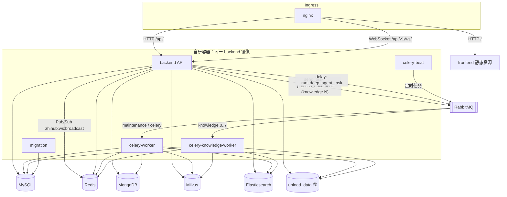
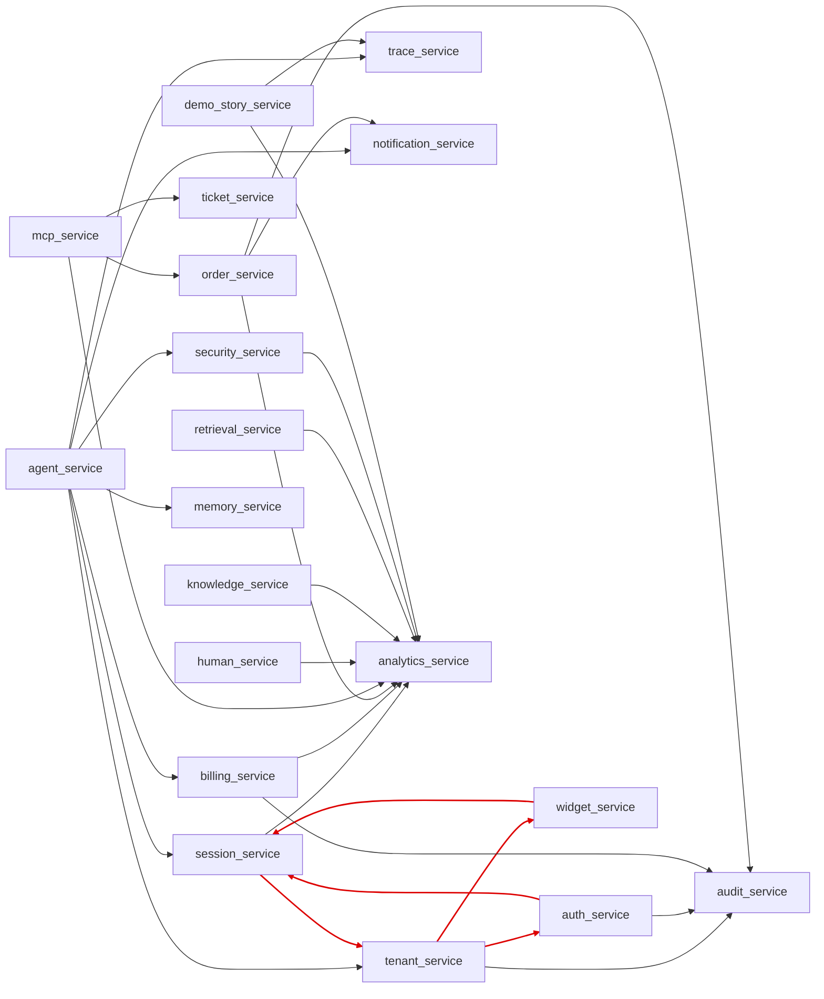

# 02 服务依赖关系图（Service Dependency Map）

> 基线：`main` @ `7c6496b`。本系统只有一个 Python 代码库（见 `00_project_inventory.md` 第 0 节），因此依赖分两个层面描述：
> - **运行时依赖**：容器之间、容器与存储/外部服务之间；
> - **代码依赖**：代码库内部各业务模块之间（这是循环依赖真正存在的地方）。

---

## 1. 运行时依赖：部署单元与通信方式

### 1.1 依赖图

### 1.2 通信方式清单

| 来源 | 目标 | 方式 | 契约位置 | 说明 |
|---|---|---|---|---|
| 浏览器 / Widget | backend | HTTP REST、SSE | FastAPI 自动生成的 `/openapi.json`；`docs/specs/*/contracts/*` | 统一前缀 `/api/v1/<module>` |
| 坐席工作台 / 终端用户 | backend | WebSocket | `app/core/ws_manager.py:203-218`（`type/payload` 信封 + 旧版平铺兼容字段） | `/api/v1/ws/agent`、终端用户会话通道 |
| 支付宝 | backend | HTTP 表单回调 | `app/api/v1/billing.py:99-118` | 公开端点，靠签名校验 |
| backend | Celery Worker | Celery 协议 over RabbitMQ | 任务名字符串，如 `app.tasks.knowledge_tasks.process_document`（`app/core/rabbitmq.py:82-86`） | **没有**独立的消息 Schema；参数为位置参数 `[doc_id, tenant_id]` |
| celery-beat | Celery Worker | Celery 协议 | `celery_worker.py:27-43` | 3 个定时任务 |
| backend 各 worker 进程之间 | 彼此 | Redis Pub/Sub | `app/core/ws_manager.py:148-162` | 跨 uvicorn worker 推送 WebSocket 事件 |
| Celery Worker | 浏览器 | **无有效通道** | — | Worker 进程未启动 Pub/Sub（`ws_manager.start_pubsub` 只在 API 生命周期中调用），在 Worker 内调用广播会直接返回。已确认受影响的场景：空闲会话自动结束时的 `session_ended` 事件（`app/tasks/cleanup_tasks.py:536-547`），见 `01_architecture_audit.md` P2-17 |
| 所有自研容器 | MySQL / Redis / Mongo / Milvus / ES | 直连共享 | — | **共享数据库模式**，没有数据访问边界（见第 4 节） |
| backend / Worker | 外部 SaaS | HTTPS | 各 `app/core/*_client.py` | 见第 1.3 节 |

### 1.3 外部服务依赖

| 外部服务 | 客户端 | 调用方 | 超时 / 降级 |
|---|---|---|---|
| DeepSeek（经 litellm） | `app/core/llm_client.py` | 对话主链路、记忆抽取、DeepAgent | `LLM_ENABLED=false` 时整条链路降级为转人工 |
| SiliconFlow（向量 + 重排） | `app/core/embedding_client.py`、`rerank_client.py` | 检索、知识入库 | `httpx.post` |
| 支付宝 | `app/core/alipay_client.py` | 账单支付、退款、退款查询 | 开发/测试环境 mock；生产禁止 mock |
| 微信公众号 | `app/core/wechat_client.py` | 扫码登录 | 未配置则 mock |
| 阿里云短信 | `app/core/sms_client.py` | 验证码 | 2.8 秒超时 |
| 百度 OCR | `app/core/ocr_client.py`（使用 `requests`） | 扫描件 PDF 兜底 | 未配置则 mock |
| RagFlow | `app/core/ragflow_client.py` | 知识解析（可选） | 失败降级本地解析 |
| SMTP | `app/core/email_client.py` | 邮箱激活、邀请 | — |
| Langfuse | `app/core/langfuse_client.py` | LLM 调用追踪 | 未配置为 no-op |

### 1.4 运行时循环依赖

容器层面**不存在**循环调用：API → MQ → Worker 是单向的，Worker 不回调 API。唯一的“回环”是支付宝回调（外部 → API），属于正常的异步通知模式。

---

## 2. 代码依赖：业务模块之间

### 2.1 service 层依赖图（基于静态 import 扫描，含函数内延迟导入）

红色边构成循环：

- **环 1**：`tenant_service → auth_service → session_service → tenant_service`
- **环 2**：`tenant_service → widget_service → session_service → tenant_service`

另外，`agents/*`（LangGraph 节点）与 `services` 之间是双向的：`agent_service` 导入 `agents.graph`，而 `agents/nodes/*` 导入 `mcp_service`、`retrieval_service`。目前通过延迟导入规避了导入期循环。

### 2.2 其他跨层依赖

| 方向 | 情况 | 评价 |
|---|---|---|
| `services/crud/core/tasks/agents/models → api` | 0 处 | ✅ 无反向依赖 |
| `crud/models/core → services` | 0 处 | ✅ |
| `api → models/select` 直接查询 | `auth.py` 1 处、`billing.py` 2 处、`demo.py` 2 处、`tenant.py` 1 处 | 🔶 少量路由绕过 service 层直接查库（如 `billing.list_invoices`） |
| `services → app.tasks` | `billing_service._notify` 导入 `notification_tasks` | 🔶 service 依赖任务模块（同步调用，不是投递任务） |
| `core/rabbitmq → celery_worker` | `publish_knowledge_task` 导入顶层 `celery_worker.celery_app` | 🔶 基础设施层依赖应用入口模块 |
| `mcp_servers → services` | `order_server` 调用 `order_service.request_refund` | ✅ 合理（适配层调用业务层） |
| `api/v1/mcp/server → mcp_servers` | 导入工具清单 `ORDER_TOOLS`、`TICKET_TOOLS` | ✅ |
| 函数内延迟导入 | 全仓 **408 处** | ❌ 依赖关系不可见，是循环依赖的掩护 |

### 2.3 公共模块评估

| 模块 | 内容 | 评价 |
|---|---|---|
| `app/core/` | 19 个文件：数据库、Redis、加密、安全、熔断、幂等、指标、WebSocket 管理，以及 10 个外部客户端 | 混合了“纯技术能力”（database、crypto、metrics）和“带业务规则的客户端”（`redis.py` 内含登录锁定状态机）。登录锁定属于身份模块业务规则，不宜放在通用 Redis 封装里 |
| `app/utils/` | 脱敏、文件解析、分词、校验、asyncio 兼容 | ✅ 基本是通用能力 |
| `app/services/analytics_service.py` | 被 10 个 service 依赖的埋点写入 | 实际上是横切能力，建议视为 `core` 级接口，并保证失败不影响主流程（当前已是旁路写入） |
| `app/services/audit_service.py` | 被 4 个 service 依赖 | 同上 |

---

## 3. API 依赖（前端 → 后端）

前端 API 模块（`frontend/src/api/*.ts`）与后端路由一一对应：

| 前端模块 | 后端前缀 | 备注 |
|---|---|---|
| `auth.ts` | `/api/v1/auth` | — |
| `session.ts` | `/api/v1/session` | 聊天窗口默认用 `sendMessageStream()`；流式失败（404/405/501 或网络类错误）时 `ChatWindow.vue:208-214` 降级调用 `sendMessage()`（别名 `sendMessageApi`）→ `POST /session/message`。该接口在 `7c6496b` 中损坏（P1-06），已在分支 `fix/session-message-route-7c6496b` 修复 |
| `tenant.ts` | `/api/v1/tenant` | — |
| `order.ts` | `/api/v1/order` | — |
| `billing.ts` | `/api/v1/billing` | — |
| `analytics.ts` | `/api/v1/analytics` | — |
| `public/widget.js` | `/api/v1/widget`、WebSocket | 嵌入第三方站点，**对外契约，兼容性要求最高** |
| WebSocket 客户端 | `/api/v1/ws/agent` | 信封同时含 `type/payload` 与旧版平铺字段 |

前后端之间**没有**自动化契约测试（前端单元测试用 mock 响应，后端契约测试只测后端）。

---

## 4. 数据库依赖（谁读写什么）

摘要见下表，完整的表归属见 `03_database_inventory.md`。

| 存储 | API 进程 | celery-worker | knowledge-worker | migration |
|---|---|---|---|---|
| MySQL | 读写全部业务表 | 读写：会话结算、计费事件、用量、账单、退款 Outbox、文档到期、租户删除 | 读写 `knowledge_documents` | DDL |
| Redis | 读写全部键族 | 读写：配额、快照、降级、presence、租户删除 | 读写：处理锁/状态（推断） | — |
| MongoDB | 写 trace、埋点；读 trace | 写/删 DeepAgent 任务、删除租户数据 | — | — |
| Milvus | 检索、写记忆 | 删除切片/记忆 | 写切片 | — |
| Elasticsearch | 检索 | 删除切片 | 写切片 | — |
| 上传卷 | 写入原始文件 | 删除文件 | 读取原始文件 | — |

**结论**：所有进程共享所有存储，没有任何“只有某个模块能写某张表”的约束。在单体内这是常见做法，但需要用代码层面的所有权约定来弥补（见 `03_database_inventory.md` 第 7 节）。

---

## 5. 消息队列依赖

| 队列 | 生产者 | 消费者 | 任务 | 可靠性配置 |
|---|---|---|---|---|
| `knowledge.0` ~ `knowledge.7` | API（`publish_knowledge_task`，按 `tenant_id % 8` 分片） | celery-knowledge-worker | `process_document(doc_id, tenant_id)` | `prefetch-multiplier=1`、`-Ofair`；**未配置** `acks_late`、超时 |
| `knowledge`（默认路由） | `task_routes` 声明 | celery-knowledge-worker | 同上 | 同上 |
| `maintenance` | celery-beat | celery-worker | `aggregate_daily_usage`、`generate_monthly_invoices`、`run_periodic_maintenance` | 同上；`concurrency=1` 保证串行 |
| `celery`（默认） | API（`run_deep_agent_task.delay`） | celery-worker | DeepAgent 长任务 | `max_retries=1` |
| `knowledge_processing`（旧） | 无 | `consume_knowledge_tasks`（旧兼容入口，未被启动） | — | 失败消息直接丢弃，无死信队列 |

Celery `backend=None`：不保存任务结果，任务状态各自写到 MySQL/Mongo。

---

## 6. 循环依赖汇总

| 层面 | 是否存在 | 详情 |
|---|---|---|
| 容器 / 进程 | 否 | — |
| 代码模块 | **是** | 环 1、环 2（见 2.1 节）；`services ↔ agents` 双向依赖 |
| 数据 | 隐式 | 会话结算（`cleanup_tasks`）→ 计费事件 → Redis 配额 → 每日聚合 → `usage_records` → 账单，多个进程沿链路接力写入，没有单一负责方 |

---

## 7. 建议调整的依赖关系

| # | 建议 | 目的 | 优先级 |
|---|---|---|---|
| D1 | 约定模块依赖方向：`core/utils ← Identity ← Tenancy ← {Knowledge, Commerce, Billing} ← Conversation ← API/Tasks`，横切的 `analytics/audit/notification` 只能被依赖、不能反向依赖业务模块 | 消除循环 | 高 |
| D2 | 打破环 1/环 2：`session_service` 对 `tenant_service` 的依赖只是“检查租户状态”，可把租户状态查询下沉到 `crud.tenant` 或独立的 `tenant_status` 小模块 | 消除循环 | 高 |
| D3 | 把登录锁定、令牌黑名单从 `core/redis.py` 移到身份模块，`core/redis.py` 只保留连接管理 | 公共模块只放技术能力 | 中 |
| D4 | `core/rabbitmq.py` 不再导入顶层 `celery_worker`，由 Celery app 工厂提供 | 基础设施不依赖应用入口 | 中 |
| D5 | 为 Celery 任务参数定义显式的数据类/Schema，并改为关键字参数 | 消息契约可演进 | 中 |
| D6 | 少数路由直接查库的地方改为调用 service | 分层一致 | 低 |
| D7 | 引入 `import-linter`，把 D1 写成 CI 规则 | 防止回退 | 高（与 D1 同时） |
| D8 | Worker 改为“只发布到 Redis 频道”，由 API 进程订阅后投递 | 修复 Worker 发出的 `session_ended` 等事件无法送达（P2-17） | 中 |

以上建议都不涉及拆分部署单元，也不改变任何对外 API。
