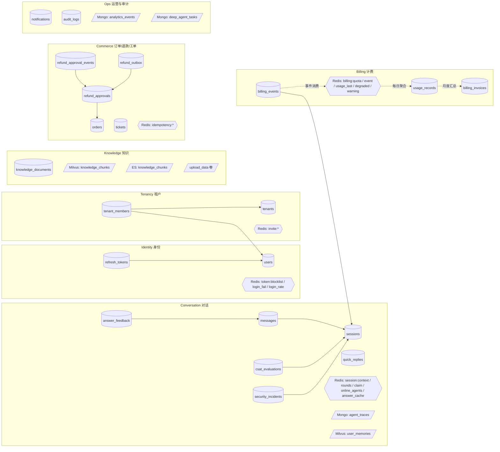

# 03 数据库审计报告（Database Inventory）

> 基线：`main` @ `7c6496b`。本阶段**未连接任何数据库**，未执行任何迁移；以下内容来自模型代码、迁移脚本、配置和业务代码的静态分析，以及在 SQLite 上运行的测试。
> 生产库的真实表结构、数据量、索引使用情况、慢查询**未经核实**，需要您提供只读访问或导出后再补充。

---

## 1. 数据库类型

本项目**只使用 MySQL 8.0 一种关系数据库**，没有使用 PostgreSQL（已经项目负责人确认，与代码一致：`backend/app/core/database.py` 只构造 `mysql+pymysql` 连接，`requirements.txt` 只有 `pymysql` 驱动）。

因此不存在“多种关系数据库并存”的边界问题，也不存在跨关系数据库的事务。本报告中的“数据库”除特别说明外均指 MySQL；Redis、MongoDB、Milvus、Elasticsearch 作为辅助存储在第 4 节单独说明。

> 说明：`deploy/docker-compose.yml` 可选 profile `observability` 中的第三方组件 Langfuse 自带一个 PostgreSQL 容器作为其内部存储，默认不启动，本项目代码不连接，不在本项目的迁移、备份与数据归属范围内。

---

## 2. MySQL

### 2.1 连接与配置

| 项 | 值 | 位置 |
|---|---|---|
| 版本 | `mysql:8.0` | `deploy/docker-compose.yml:76` |
| 驱动 | `pymysql`（同步），URL 带 `charset=utf8mb4` | `backend/app/core/database.py:47-52` |
| ORM | SQLAlchemy 2.0，同步 `Session`，`autoflush=False`、`autocommit=False` | `backend/app/core/database.py:57-61` |
| 连接池 | `create_engine(..., pool_pre_ping=True)`，**其余使用默认值**（`QueuePool`，`pool_size=5`、`max_overflow=10`，无 `pool_recycle`） | `backend/app/core/database.py:57` |
| 每进程最大连接 | 15（默认池）× 进程数。API 有 2 个 uvicorn worker，再加 3 个 Celery 进程（knowledge worker 并发 2），总计约 15 × 6 ≈ 90 个连接上限（推断） | — |
| 库数量 | 1 个库（`MYSQL_DATABASE`，默认 `zhihub`），**无多库配置、无读写分离** | — |
| 事务隔离级别 | 未显式设置，使用 MySQL 默认 `REPEATABLE READ` | — |
| 时区 | 未显式设置。Python 写入 UTC 的无时区时间；`created_at`/`updated_at` 由 MySQL `func.now()` 按**数据库服务器时区**生成 | `backend/app/models/base.py` |
| 特殊启动参数 | `--log-bin-trust-function-creators=1`（为创建触发器） | `deploy/docker-compose.yml:77` |

### 2.2 连接池评估

- `pool_size=5 / max_overflow=10` 对 API 进程偏小：同步端点运行在 AnyIO 线程池（默认 40 线程），并发超过 15 个需要数据库的请求时会在连接池上排队（默认 30 秒超时后报错）。另外，流式请求在整个生成期间持有请求级 Session（`agent_service.py:1141-1178`），会进一步占用连接。
- 没有 `pool_recycle`，依赖 `pool_pre_ping` 剔除断开的连接，可以工作，但每次取连接多一次往返。
- 11 处代码自行 `SessionLocal()`（见 `01_architecture_audit.md` P1-08），在请求内额外再占一个连接，例如转人工时 `agent_service.py:170,216` 会在持有请求连接的同时再开两个短连接。

建议在压测基础上明确设置池参数，并加连接池监控指标。

---

## 3. 数据表清单与归属

### 3.1 表清单（21 张业务表 + `alembic_version`）

| 表 | 主要字段 / 约束 | `tenant_id` | 关键外键 | 建议归属模块 |
|---|---|---|---|---|
| `tenants` | `plan_type`、`status`、`quota_conversations_per_month`、`seat_limit`、注销字段、Widget 配置、`refund_approval_threshold`、`default_model`、`is_demo` | —（自身） | — | Tenancy |
| `users` | 手机/邮箱/微信 openid 加密列 + `*_hash` 唯一索引、`password_hash`、锁定字段 | 无（平台级，可属于多个租户） | — | Identity |
| `tenant_members` | `uq_tenant_user(tenant_id, user_id)`、`role` | 有 | `tenants`、`users` | Tenancy |
| `refresh_tokens` | `token_hash` 唯一、`family_id`、`parent_token_id` 自引用、`status` | 有 | `users`、`tenants`、自身 | Identity |
| `sessions` | `status`、`intent`、`confidence`、`assignee_id`、`end_user_id`、`effective_reply`、`billed` | 有 | `users`（assignee） | Conversation |
| `messages` | `role`、`content`、`sources`(JSON)、`metadata`(JSON，含 `tokens`) | **无**（经 `sessions` 间接隔离） | `sessions` | Conversation |
| `answer_feedback` | `message_id` 唯一 | 无 | `messages` | Conversation |
| `csat_evaluations` | `session_id` 唯一 | 无 | `sessions`、`messages` | Conversation |
| `quick_replies` | `content`、`shortcut` | 有 | — | Conversation |
| `security_incidents` | 命中规则、风险等级、处置动作 | 有 | `sessions` | Conversation（安全） |
| `knowledge_documents` | `status`、`version`、`is_latest`、`chunk_count`、`expires_at`、`quality_status` | 有 | — | Knowledge |
| `tickets` | `ticket_no` **全局唯一**、`status`、`priority`、`phone`（加密）、`category`、`created_by` | 有 | `users`（assignee） | Commerce |
| `orders` | `order_no` **全局唯一**、`amount`/`paid_amount` Numeric(10,2)、`status`、`version`（乐观锁）、`phone`（加密）、`payment_trade_no`、`tracking_no` | 有 | — | Commerce |
| `refund_approvals` | `uq(order_id, client_request_id)`、`amount`、`status`、`pre_status`、`review_history`(JSON 文本) | **无**（经 `orders` 间接隔离） | `orders`、`users` | Commerce |
| `refund_approval_events` | 只追加；MySQL 触发器禁止 UPDATE/DELETE（租户清理时通过会话变量放行） | 无 | `refund_approvals`、`users` | Commerce |
| `refund_outbox` | `uq(approval_id)`、`status`、`attempts`、`processing_at`（租约） | 无 | `refund_approvals`、`orders` | Commerce |
| `billing_events` | `uq(session_id)`、`uq(event_key)`、`usage_amount` Numeric(16,6)、`status`、`attempts` | 有 | `sessions` | Billing |
| `usage_records` | `uq(tenant_id, date)`、`conversation_count`、`snapshot_total`、`is_overage` | 有 | — | Billing |
| `billing_invoices` | `uq(tenant_id, period)`、`base_fee`/`overage_fee` Numeric(10,2)、`status`、`payment_trade_no` 唯一 | 有 | — | Billing |
| `notifications` | `user_id` 可空（全员）、`type`、`read_at` | 有 | — | Ops |
| `audit_logs` | `action`、`target_type/id`、`detail` | 有 | `users` | Ops |

注意：
- 大多数表的 `tenant_id` **没有外键**指向 `tenants`（只有 `tenant_members`、`refresh_tokens` 有），租户删除依赖应用代码按顺序清理（`cleanup_tasks.py:388-466`）。
- `messages`、`refund_approvals`、`refund_approval_events`、`refund_outbox`、`answer_feedback`、`csat_evaluations` 没有 `tenant_id`，所有查询都必须经父表 join 才能做租户隔离。目前代码是这样做的（例如 `order_service.py:284-288` 经订单校验审批归属），但这是一个需要长期保持的隐式约定。

### 3.2 谁在读写每张表（静态引用扫描）

下表是“哪些模块引用了该模型或其 CRUD”，不区分读写；粗体表示多个业务模块都会触达，需要特别关注归属。

| 表 | 引用模块 |
|---|---|
| `tenants` | **18 个模块**：deps、auth、demo、tenant 路由；auth/billing/knowledge/order/tenant/widget/analytics/demo_story service；billing/cleanup/knowledge tasks；widget_cors 中间件；demo_seed |
| `sessions` | **17 个模块**：session/widget/ws 路由；agent/human/session/billing/tenant/analytics/demo_story service；answer_feedback/billing/csat/session crud；cleanup_tasks；`main.py`（指标） |
| `messages` | crud.session、crud.answer_feedback、billing_service（token 统计）、tenant_service（导出）、demo_story_service、cleanup_tasks、demo_seed |
| `orders` | order 路由、crud.order、order_server、order/session/tenant/analytics service、cleanup_tasks、demo_seed |
| `tickets` | ticket 路由、crud.ticket、ticket_server、ticket/human/session/tenant service、deep_agent planner、cleanup_tasks、demo_seed |
| `billing_invoices` | billing 路由（直接查询）、billing/order/tenant/analytics service、cleanup_tasks、demo_seed |
| `usage_records` | billing_service、billing_tasks、tenant/analytics service、cleanup_tasks、demo_seed |
| `users` | deps、auth/tenant 路由、crud.user、auth/tenant service、notification_tasks、cleanup_tasks、demo_seed |
| `refund_*`（3 张） | crud.order、order_service、session/tenant/analytics service、cleanup_tasks |
| 其余表 | 基本只由所属模块 + `cleanup_tasks`（租户删除）+ `tenant_service`（数据导出）+ `analytics_service`（看板）触达 |

**结论**：没有“多个服务直接修改同一业务数据”的跨服务问题（因为只有一个代码库），但在代码库内部，`sessions`、`tenants`、`orders` 被多个模块直接写入，没有统一入口。例如会话状态会被 `agent_service`、`human_service`、`session_service`、`cleanup_tasks` 各自更新，状态流转规则分散在这些文件中。

---

## 4. 非关系型存储

### 4.1 Redis（同步单例 `app/core/redis.py:72-90` + Pub/Sub 异步客户端 `app/core/ws_manager.py:79-85`）

| 键族 | 用途 | TTL | 是否权威数据 | 主要位置 |
|---|---|---|---|---|
| `billing:quota:{tenant}:{YYYY-MM}` | 当月用量计数（浮点） | 40 天 | **是**（账单回退来源、实时预警来源） | `billing_service.py:61-71` |
| `billing:event:{event_key}` | 计费事件去重 | **永不过期** | 是 | `billing_service.py:112-126` |
| `billing:usage_last:{tenant}:{month}` | 每日聚合快照位点 | 60 天 | **是**（丢失会导致下次聚合重复/错算） | `billing_tasks.py:40-47,117-118` |
| `billing:warning:*`、`warning_banner:*` | 预警去重与横幅 | 40 天 | 否 | `billing_service.py:47-51` |
| `billing:degraded:{tenant}` | 逾期降级标记 | 24 小时（每日刷新） | 派生数据（可由 MySQL 重算） | `billing_service.py:695-751` |
| `idempotency:{order_id}:{client_request_id}` | 退款幂等结果缓存 | 24 小时 | 否（MySQL 唯一约束兜底） | `core/idempotency.py` |
| `claim:session:{id}` | 坐席认领锁 | 5 分钟 | 否（MySQL 状态兜底） | `human_service.py:38-39` |
| `session:context:{id}` | 最近 10 条对话上下文 | 30 分钟滑动 | 否（MySQL `messages` 有全量） | `session_service.py:44-80` |
| `session:rounds:*` | 轮次计数（转人工判定） | 30 分钟 | 是（影响转人工） | `session_service.py:91-98` |
| `online_agents:{tenant}:{user}` | 坐席在线状态 | 有 TTL | 否 | `session_service.py:196-254` |
| `token:blocklist:{jti}` | 登出黑名单 | 令牌剩余有效期 | **是**（丢失=已登出令牌恢复有效） | `core/redis.py:234-264` |
| `login_fail:*`、`login_fail_ip:*`、`login_rate:*` | 登录失败计数与锁定、IP 频率 | 15 分钟 / 2 分钟 | 是（安全控制） | `core/redis.py:113-230` |
| `invite:*` | 邀请令牌 | 7 天 | **是**（唯一存储） | `tenant_service.py:63` |
| `answer_cache:{tenant}:{sha256}` | 常见问题回答缓存 | 1 小时 | 否 | `agent_service.py:71-111` |
| 限流令牌桶、熔断计数 | 限流与熔断 | 短 | 否 | `rate_limit_service.py`、`core/circuit_breaker.py` |
| 频道 `zhihub:ws:broadcast` | 跨 worker WebSocket 广播 | — | 否 | `core/ws_manager.py` |

**部署现状**：Compose 中 Redis 无数据卷、无 AOF/RDB 显式配置、`mem_limit: 256m`、无 `maxmemory-policy`（`deploy/docker-compose.yml:107-119`）。见 `01_architecture_audit.md` P1-03。

### 4.2 MongoDB

| 集合 | 写入方 | 读取方 | TTL | 备注 |
|---|---|---|---|---|
| `agent_traces` | `trace_service.save_trace`（API 进程守护线程，motor 异步，每次新建客户端） | `trace_service.get_trace_by_session`（会话 trace 接口）、演示 | 有 TTL 索引（`trace_service` 中确保） | 库名写死 `client.zhihub` |
| `analytics_events` | `analytics_service.track_event`（pymongo 同步单例） | 运营看板 | 未确认 | 库名写死 `["zhihub"]` |
| `deep_agent_tasks` | `core/deep_agent_store.py`（pymongo） | DeepAgent 接口 | 未确认 | 库名写死 `["zhihub"]` |

`MONGO_URI` 默认 `mongodb://mongo:27017/zhihub`，但代码不使用 URI 中的库名。若生产 URI 指向其他库名，写入与删除都会落在 `zhihub` 库（见 P2-09）。

### 4.3 Milvus 与 Elasticsearch

| 存储 | 集合/索引 | 内容 | 写入方 | 删除方 |
|---|---|---|---|---|
| Milvus | `knowledge_chunks` | 知识切片向量 | knowledge worker | 文档到期清理、版本替换、租户删除 |
| Milvus | `user_memories` | 终端用户长期记忆向量 | API 进程（守护线程） | 租户删除 |
| Elasticsearch | `knowledge_chunks` | 切片全文（BM25） | knowledge worker | 同 Milvus 切片 |

MySQL 的 `knowledge_documents.chunk_count/status` 与 Milvus/ES 中的切片之间没有事务，一致性依赖处理任务的状态机和周期维护（`cleanup_tasks.py:836-890` 先删检索库、成功后才标记过期）。

### 4.4 文件存储

上传原始文件写入 `UPLOAD_STORAGE_DIR`（Compose 中为共享卷 `/data/uploads`），文件名 `{doc_id}_{basename}`（`knowledge_service.py:156-166`）。API 与 knowledge worker 必须挂载同一卷，**多主机部署时需要共享存储**（需确认）。

---

## 5. 数据库归属关系图

实线为外键；虚线为跨存储的数据流（无事务保证）。所有表的 `tenant_id` 逻辑上都归属于 `tenants`，图中未逐一画出。

---

## 6. ORM 与迁移机制

| 项 | 现状 | 评价 |
|---|---|---|
| 迁移工具 | Alembic，38 个迁移文件，**单一 head**（`d37_tenant_cancellation`），历史上有一次分支与合并（`36e0613c0a65`） | ✅ |
| 迁移执行 | Compose 中的一次性 `migration` 容器，其他容器依赖其成功完成 | ✅ 迁移失败时不会对外服务 |
| `create_all` 兜底 | 仅在未检测到 `alembic_version` 且非生产时执行；生产直接报错 | ✅ |
| 漂移检测 | CI 在真实 MySQL 上执行 `alembic upgrade head` + `alembic check` | ✅ |
| 方言相关 DDL | 退款事件不可变触发器只在 MySQL 上创建（`d30`、`d33`、`d37`），SQLite 测试不执行 | 🔶 见 `04_testing_assessment.md` |
| 降级（downgrade） | 未逐个审阅是否都实现；`test_alembic_from_scratch` 在本机被跳过（需 `MYSQL_ROOT_PASSWORD`） | ⚠️ 需确认回滚能力 |
| 迁移归属 | 只有一个代码库、一条迁移链，归属明确 | ✅ |
| 命名 | 版本号以 `d3`、`d4b`、`d10_*` 等手工编号为主，`d12`~`d15`、`d35` 缺号（`d35` 实际为 `3265167fe1f3`） | 🔶 不影响运行，可读性一般 |
| 数据迁移与结构迁移 | 混在同一迁移中（如 `d9_pii_encryption`、`d28_*` 涉及数据加密） | 🔶 大表上可能长时间锁表，需在生产前评估 |

---

## 7. 事务与数据一致性

### 7.1 事务边界

- 请求级：`get_db` 每请求一个 Session，`close()` 时未提交的事务自动回滚（`core/database.py:64-79`）。事务的 `commit` 由 service 层显式调用，全仓 service 层 69 处、tasks 16 处、mcp_servers 3 处、api 2 处、demo 9 处。
- 单个请求内**多次提交**很常见。例如一次对话：保存用户消息 + 状态改为 `routing` 提交一次（`agent_service.py:540-542`），保存助手消息 + 更新会话状态再提交一次（`:612`）；中间调用外部 LLM。中途失败会留下“用户消息已保存、会话状态为 routing”的中间态。
- 智能体调用 MCP 工具时使用独立 Session 与独立提交（P2-11）。

### 7.2 并发控制

| 场景 | 机制 | 评价 |
|---|---|---|
| 订单状态 | `version` 乐观锁 CAS（`crud.order.update_status_optimistic`） | ✅ |
| 退款审批终审 | 条件更新 `WHERE status='pending'` 原子抢占 | ✅ |
| 退款 Outbox | 租约 `processing_at` + 条件更新 | ✅ |
| 账单支付 | 条件更新 `WHERE status='unpaid'` | ✅ |
| 会话结算计费 | `claim_idle_session_for_billing` 条件更新 + `billing_events.session_id` 唯一 | ✅ |
| 租户删除 | `SELECT ... FOR UPDATE`，但持锁期间执行外部 IO | 🔶 P2-09 |
| 坐席认领 | Redis `SET NX` 锁 + 状态检查；数据库更新本身不是条件更新 | 🔶 依赖 Redis；锁过期后由状态检查兜底，可接受 |
| 会话上下文 | 无 | ❌ P2-06 |
| 知识库同名文档版本 | `mark_not_latest` + 新建，无唯一约束保证只有一个 `is_latest` | ⚠️ 需确认（有 `test_knowledge_reset_concurrency` 集成测试覆盖部分场景） |

### 7.3 跨存储一致性

| 链路 | 涉及存储 | 一致性方式 | 风险 |
|---|---|---|---|
| 会话 → 计费 | MySQL `billing_events` → Redis 配额 → MySQL `usage_records` → MySQL `billing_invoices` | 事件表 + Redis 事务内去重 + 每日快照位点 | P1-01、P1-02、P1-03 |
| 知识入库 | MySQL 文档状态 ↔ Milvus ↔ ES ↔ 文件卷 | 任务状态机 + 周期维护 | 中 |
| 租户删除 | MySQL ↔ Mongo ↔ Milvus ↔ ES ↔ Redis ↔ 文件卷 | 先外部后 MySQL、失败下轮重试 | P2-09 |
| 对话 trace | MySQL 消息 ↔ Mongo trace | 尽力写入，失败丢弃 | P1-07（可接受丢失，但需要可见） |

---

## 8. 数据库风险汇总

| 风险 | 等级 | 说明 |
|---|---|---|
| Redis 权威数据无持久化 | P1 | P1-03 |
| 月末用量漏计 / 配额口径不一致 | P1 | P1-01、P1-02 |
| PII 密钥与 JWT 耦合 | P1 | P1-04 |
| 测试不覆盖 MySQL 方言行为 | P1 | P1-08 |
| 租户删除跨存储非原子、Mongo 库名写死 | P2 | P2-09 |
| 订单号/工单号全局唯一 | P2 | P2-10 |
| 时区未统一（Python UTC vs MySQL `NOW()`） | P2 | P2-13 |
| 连接池使用默认参数 | P2 | 第 2.2 节 |
| `usage_records.date LIKE 'YYYY-MM-%'` 对 `DATE` 列做字符串匹配，不能使用索引 | P3 | `billing_service.py:373-376`，数据量小时影响不大 |
| 多张子表无 `tenant_id`，隔离依赖 join | P3 | 第 3.1 节 |
| 大表数据迁移与结构迁移混合 | P3 | 第 6 节 |
| 索引现状 | 未核实 | 需要生产库 `SHOW INDEX` 与慢查询日志 |

---

## 9. 建议的 Database Ownership 机制

在单体内不需要拆库，但需要“谁能写什么”的明确约定：

1. **表归属登记**：以第 3.1 节“建议归属模块”为准，每张表只有一个所属模块。所属模块提供写入函数（service 或 crud），其他模块只能调用这些函数，**不得直接修改该表的 ORM 对象或执行 UPDATE**。读取可以放宽，但跨模块的复杂查询应集中到所属模块的查询函数中。
2. **例外清单化**：`cleanup_tasks`（租户删除）和 `tenant_service`（数据导出）天然需要触达所有表，作为登记在案的例外，并要求每新增一张表时同步更新删除与导出逻辑（可用测试检查：遍历 `Base.metadata.tables`，断言每张表都出现在删除清单中）。
3. **Redis 键归属**：为每个键族登记所属模块、TTL、是否权威数据（第 4.1 节表格可作为初稿），统一键名前缀工具函数，禁止在业务代码中拼写裸字符串键。
4. **Mongo/Milvus/ES 归属**：每个集合/索引登记所属模块；连接与库名统一从配置读取。
5. **状态流转集中**：`sessions.status`、`orders.status`、`tenants.status` 的修改各自只经过一个函数，便于审计和测试状态机。
6. **约束落地**：在 CI 中用 `import-linter` 限制“只有所属模块可以导入某个 `models` 子模块进行写操作”的规则（读操作可通过约定放宽），逐步收紧。

以上机制只涉及代码组织和测试，不需要修改数据库结构。
